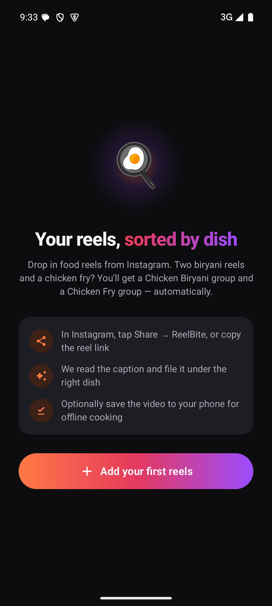
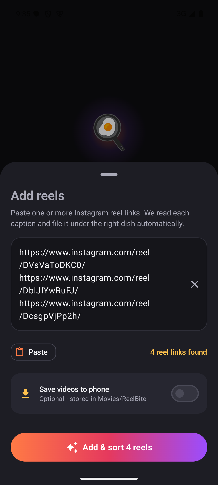
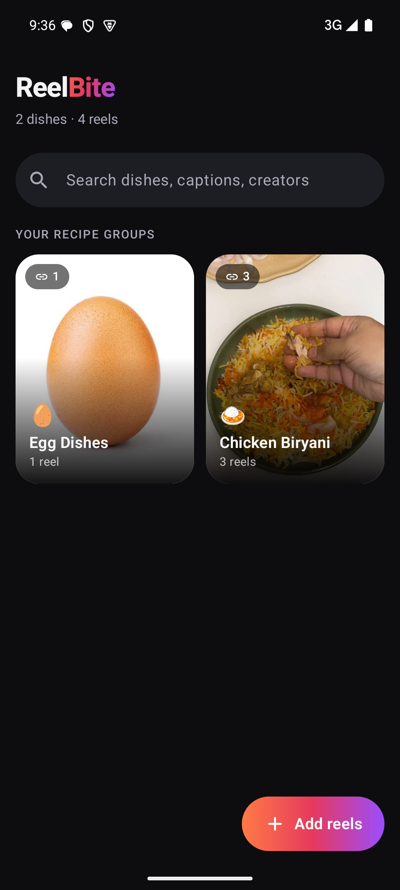
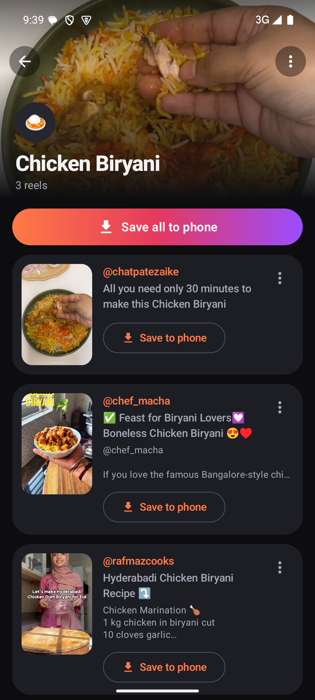

# ReelBite

**ReelBite** turns your saved Instagram food reels into a tidy recipe box. Share or paste reel links and ReelBite reads each caption and files the reel under the right dish automatically: two biryani reels and a chicken fry reel become a **Chicken Biryani** group and a **Chicken Fry** group. You can also save the videos to your phone to cook from offline.

**[⬇ Download the latest APK](https://github.com/tarun337/reelbite/releases/latest/download/ReelBite.apk)** (Android 10+) · [All releases](https://github.com/tarun337/reelbite/releases). See [Installing on a phone](#installing-on-a-phone).

<p align="center">
  
  
  
  
</p>

## Features

**Add reels your way**
- In Instagram, tap **Share → ReelBite**, or paste links into the app
- Paste one link or a whole batch at once, in any format (one per line, space-separated, or inside shared text)
- Understands `/reel/`, `/reels/`, `/p/`, `/tv/`, `username/reel/…` and `?igsh=` share links, and skips reels you've already added

**Automatic grouping by dish**
- Reads each reel's caption and hashtags, then combines the **dish** with the **main ingredient**: *Chicken Biryani*, *Mutton Biryani*, *Chicken Fry*, *Paneer Tikka*, *Egg Curry*…
- Knows 90 dishes (biryani, pulao, fried rice, 65, manchurian, tikka, kebab, dosa, paratha, pizza, pasta, cakes, drinks…) and 21 main ingredients
- Copes with spelling variants (*biriyani*, *chiken*), glued hashtags (`#hyderabadichickenbiryani`) and regional names (*kodi vepudu*, *murgh*, *gosht*)
- Isn't fooled by ingredient lists and cooking steps: "garam masala", "curry leaves" and "fry the onions" don't create false groups
- The title at the top of a caption counts more than hashtags at the bottom, and main dishes win over cooking styles ("chicken fry piece biryani" is a biryani)
- Runs fully on the phone; no AI service or account needed

**You stay in control**
- Reels it can't recognise go to an **Unsorted** inbox. Type the dish name and they're filed instantly; any name works, even a new one like "Grandma's Special"
- Move a reel to another group or a brand-new one
- Rename groups; renaming to an existing group's name merges the two
- Remove reels or whole groups, optionally deleting their saved videos too

**Save videos to your phone (optional)**
- Off by default. Switch it on when adding reels, per reel, or with **Save all** on a group
- Videos go to `Movies/ReelBite` and show up in your gallery; no storage permission needed
- Live progress, resumes automatically if the connection drops, and **Play offline** from the app
- If you delete a video from the gallery, ReelBite notices when you tap Play and lets you save it again

**Designed dark**
- Dark-first Material 3 design with a warm saffron-to-purple accent
- Photo cards for every dish, search across dish names, captions and creators

## How it works

1. **Reading the reel.** ReelBite asks Instagram's public oEmbed endpoint for the caption, creator and thumbnail. If that doesn't answer, it falls back to Instagram's public embed page, loaded in a hidden WebView. Thumbnails are cached on the phone because Instagram's image links expire.
2. **Sorting.** An offline keyword classifier (`domain/RecipeClassifier.kt`) scores dish and ingredient mentions and picks the best pair. Each group has a stable key (for example `biryani|chicken`), so renamed groups keep collecting new reels of the same dish.
3. **Saving.** For saving, the video file address is read from the embed page and the MP4 is streamed into MediaStore.

## Limitations

- **Some reels can't be saved.** Instagram only plays reels with licensed music inside its own app, so their video isn't available to download. Many food reels use licensed music. ReelBite shows a clear message for these, and they can still be grouped and opened in Instagram.
- **Public reels only.** Private accounts can't be read.
- **Unofficial endpoints.** ReelBite uses Instagram's public oEmbed and embed pages, not an official API, so an Instagram change can break caption reading or saving until the app is updated.
- **Keyword-based grouping.** A caption that never names the dish (for example "watch till the end 😂") lands in Unsorted for you to name.
- **Respect creators.** Only save reels you have the right to keep, for personal offline viewing. Downloading content may be against Instagram's terms of use.

## Tech stack

- Kotlin, Jetpack Compose, Material 3
- Room (SQLite) for local storage, ViewModel + StateFlow, Navigation Compose
- OkHttp for networking, Coil for images, an off-screen WebView for the embed page
- MediaStore for saving videos without storage permissions
- Min SDK 29 (Android 10), target SDK 35

## Building

Requirements: JDK 17+ and the Android SDK (platform 35, build-tools 35).

1. Point Gradle to your SDK by creating `local.properties` in the project root:
   ```properties
   sdk.dir=/path/to/Android/sdk
   ```
2. Run the unit tests (grouping logic and link parsing):
   ```bash
   ./gradlew testDebugUnitTest
   ```
3. Build a release APK:
   ```bash
   ./gradlew assembleRelease
   ```
   The APK is written to `app/build/outputs/apk/release/app-release.apk`.

> The release build is signed with the local **debug key** so it can be sideloaded directly. For a Play Store release, configure your own signing key in `app/build.gradle.kts`.

## Installing on a phone

[Download the APK](https://github.com/tarun337/reelbite/releases/latest/download/ReelBite.apk) on your phone and open it (allow "Install unknown apps" when prompted). To install a build from source with USB debugging enabled:

```bash
adb install -r app/build/outputs/apk/release/app-release.apk
```

## Project structure

```
app/src/main/java/com/reelbite/app/
├── ReelBiteApp.kt       Application + manual dependency container
├── MainActivity.kt      Navigation, share-intent handling
├── domain/
│   ├── RecipeClassifier.kt  Caption → dish group scoring
│   ├── DishCatalog.kt       Dishes, ingredients and their aliases
│   └── InstagramLinks.kt    Link extraction from pasted / shared text
├── data/
│   ├── RecipeRepository.kt  Add → read → sort → save pipeline, user edits
│   ├── VideoSaver.kt        MediaStore video saving
│   ├── SettingsStore.kt     Remembers the "save videos" choice
│   ├── db/                  Room entities, DAOs, database
│   └── remote/              oEmbed client, resumable downloads, embed-page reader
└── ui/
    ├── home/            Recipe grid, search, add-reels sheet
    ├── group/           Group screen and reel cards
    ├── components/      Shared UI pieces and dialogs
    └── theme/           Colours, typography, shapes
```

**Teaching it new dishes:** add a `Dish` (with its aliases) or an `Ingredient` to `DishCatalog.kt`, then add a case to `RecipeClassifierTest.kt`.

## Privacy

There's no account and no ReelBite server. Your reels, groups and thumbnails are stored only on your phone. The app only talks to Instagram, to read the reels you add and, if you choose, to download their videos. The only permission it uses is internet access.
